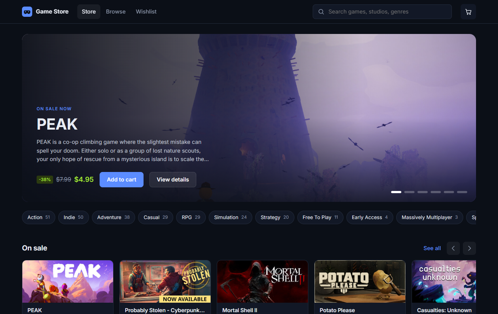

# Game Store

A game shop that runs on real Steam Store data: current prices, sales, screenshots, genres and system
requirements for around a hundred games. It's rebuilt every morning, so the prices you see are at most a day old.

**[Open the live store](https://byocao.github.io/game-store/)**



## What you can do

- Browse today's sales, top sellers, new releases and upcoming games
- Search by name, studio or genre, filter by price and genre, and sort by price, discount or Metacritic score.
  Filters live in the URL, so any view can be bookmarked or shared
- Open a game for its screenshots, description, features and minimum PC requirements, plus similar games
- Keep a wishlist and a cart. Both are saved in your browser and stay in sync across tabs

It's a portfolio project, so checkout doesn't take payments: it sends you to each game's Steam page instead.

## How it works

```
GitHub Actions (daily) ──> scripts/fetch-steam.mjs ──> public/data/catalog.json ──> vite build ──> GitHub Pages
                             Steam Store API
```

The browser never talks to Steam. Steam's store API has no CORS headers and a rate limit, so a scheduled
workflow fetches the data once a day, writes it to a JSON file and publishes a static build. If Steam can't be
reached, the workflow deploys the last catalog committed to the repo.

- **Frontend:** React 19, TypeScript, React Router, plain CSS. No UI framework
- **Build:** Vite, served from GitHub Pages
- **Data:** Steam Store `featuredcategories` and `appdetails` endpoints, US region
- **Quality:** ESLint, Vitest unit tests for search, filters, the cart and the Steam HTML parser

## Running it locally

Needs Node.js 20 or newer.

```bash
npm install
npm run dev          # http://localhost:5173/game-store/
```

Other scripts:

| Command | What it does |
| --- | --- |
| `npm run fetch-data` | Pull fresh data from Steam into `public/data/catalog.json` (takes about 2 minutes) |
| `npm test` | Run the unit tests |
| `npm run lint` | Lint the project |
| `npm run build` | Type-check and build to `dist/` |

## History

The first version (2023) was a Create React App project with 25 hard-coded games. Version 2 is a rewrite:
live Steam data, TypeScript, Vite, a real game page, saved cart and wishlist, tests and automatic deploys.

---

Not affiliated with Valve or Steam. Game names, images and descriptions belong to their owners.
